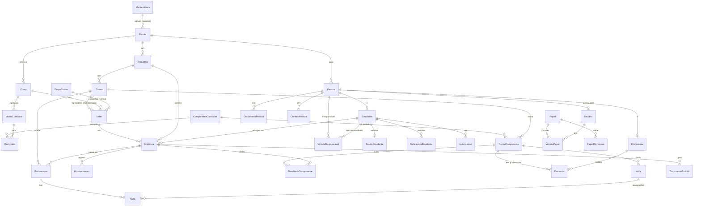

# 2. Domínio-alvo — o modelo de uma escola real

> **Resumo.** Este documento descreve **como o Áxis deveria enxergar uma escola** depois da revisão, independente de como o código está hoje.
> A mudança central é separar quatro ideias que hoje estão misturadas: **a pessoa** (quem é: nome, documentos, endereço), **o papel dela na escola** (estudante, responsável, professor, secretaria...), **a vida escolar** (em que ano, curso e turma o estudante esteve, e o que aconteceu: aprovação, transferência, abandono) e **a conta de acesso** (login e senha).
> Com isso, o estudante passa a ter cadastro completo (documentos, saúde, deficiência, transporte, autorizações), os responsáveis passam a existir com vínculos claros (filiação, responsável legal, financeiro, quem pode buscar), e cada ano letivo vira uma **matrícula** própria, com **enturmações** (passagens por turmas) e **movimentações** registradas — o que permite histórico escolar, documentos e exportação para o Censo Escolar.
> A estrutura da escola ganha **etapas e modalidades no padrão do Censo** (infantil a EJA e técnico), um **catálogo de componentes curriculares** e uma **matriz curricular** de verdade.
> Os booleanos de papel (`isDirecao`, `isStaff`...) são trocados por **papéis com permissões**, com um caminho de migração que não quebra a CETEP.
> No fim há um diagrama das entidades e a lista do que é decisão de produto (detalhada no documento 6).

---

## 2.1 Princípios do modelo

1. **A escola continua sendo o "inquilino"** (*tenant*: a unidade que isola os dados). Toda tabela nova com dado de pessoa ou de vida escolar tem `escolaId` **próprio** — nada de isolamento "por caminho" (via turma ou via professor), que é frágil (ver inventário 1.7).
2. **Pessoa ≠ papel ≠ conta.** Uma mesma pessoa pode ser mãe de um aluno e professora da escola; pode ter ou não um login. Isso evita cadastrar a mesma pessoa duas vezes.
3. **Nada da vida escolar é apagado ou sobrescrito.** Mudar de turma, transferir, abandonar ou concluir gera um **registro com data**, não uma troca de campo. O histórico sai disso.
4. **Vocabulário de sistema acadêmico brasileiro** (o que o professor já conhece do SIGEduc, i-Educar, SUAP): *matrícula*, *enturmação*, *remanejamento*, *componente curricular*, *unidade/etapa*, *situação final*, *diário de classe*, *ata de resultados finais*, *histórico escolar*.
5. **Alinhado ao Censo Escolar (Educacenso/INEP)**: os campos e as listas de opções (cor/raça, nacionalidade, deficiência, transporte, etapa de ensino) seguem as categorias do Censo, para a exportação ser uma conversão direta e não um "de-para" manual.
6. **Dados sensíveis separados** (saúde, deficiência, CID, decisões judiciais): ficam em tabelas próprias, com permissão própria e registro de quem leu (LGPD, seção 2.8).

---

## 2.2 Pessoa e cadastros

### 2.2.1 Pessoa (a base de todos)

`Pessoa` guarda o que identifica alguém, seja estudante, responsável ou profissional. Uma linha por pessoa **por escola** (ver decisão D-05 no documento 6 sobre compartilhar pessoas entre escolas de uma mesma rede).

| Grupo | Campos | Observação |
|---|---|---|
| Identificação | nome civil, **nome social** (Decreto 8.727/2016 e normas de educação: o nome social aparece nas telas e chamadas; o civil nos documentos oficiais quando exigido), data de nascimento, sexo (como o Censo pede), cor/raça (branca, preta, parda, amarela, indígena, não declarada) | Abaixo de 16 anos, a cor/raça é **declarada pelo responsável**; a partir de 16, autodeclaração. Guardar quem declarou |
| Nacionalidade | nacionalidade (brasileira, brasileira nascida no exterior/naturalizada, estrangeira), país de nascimento, UF e município de nascimento (código IBGE) | Código IBGE evita "Salvador", "salvador-ba", "SSA" |
| Documentos | CPF, RG (número, órgão emissor, UF, data de expedição), certidão de nascimento (modelo novo: matrícula de 32 dígitos; modelo antigo: livro/folha/termo/cartório), NIS (Número de Identificação Social — usado no Bolsa Família e no acompanhamento de frequência do programa), Cartão Nacional de Saúde (SUS), passaporte/RNM para estrangeiros | Tabela `DocumentoPessoa` (tipo + número + dados extras), para não criar 20 colunas vazias |
| Endereço | CEP, logradouro, número, complemento, bairro, município (IBGE), UF, **zona de residência (urbana/rural)**, localização diferenciada (área de assentamento, terra indígena, quilombola) | Zona e localização diferenciada são campos do Censo |
| Contatos | telefones (tipo: celular, residencial, trabalho, recado; se tem WhatsApp), e-mails | Tabela `ContatoPessoa`, vários por pessoa |
| Foto | foto (opcional) | Uso de imagem depende de autorização (2.2.4) |

### 2.2.2 Estudante

`Estudante` = uma `Pessoa` no papel de aluno daquela escola. Guarda o que é **permanente** do aluno; o que é **de cada ano** vai para `Matricula` (2.3).

| Grupo | Campos |
|---|---|
| Identificação escolar | código interno da escola (o "número de matrícula" que a CETEP usa hoje continua existindo como **código do estudante**), **código INEP do aluno** (ID gerado pelo Educacenso), RA/código da rede estadual (quando a rede tiver) |
| Transporte | usa transporte escolar público? (sim/não); poder público responsável (municipal/estadual); tipos de veículo (rodoviário: vans, micro-ônibus, ônibus, bicicleta, tração animal, outro; aquaviário: embarcações por capacidade) — listas do Censo |
| Programas sociais | beneficiário de programas (ex.: Bolsa Família — informar NIS) — opcional, sensível |
| Situação de vida | **restrição judicial** de convívio/guarda (quem não pode buscar ou receber informação) — sensível, só secretaria e direção |
| Observações | observações gerais da secretaria |

### 2.2.3 Saúde, deficiência e AEE (tabelas sensíveis)

| Tabela | Campos | Quem vê |
|---|---|---|
| `SaudeEstudante` | tipo sanguíneo, **alergias** (alimentar, medicamentosa, outras — com gravidade), **medicações de uso contínuo** (nome, dose, horário, se a escola administra e com qual autorização), restrições alimentares, condições crônicas (asma, diabetes, epilepsia...), plano de saúde, orientações em caso de emergência | Secretaria, direção, coordenação; professores veem **só o resumo de alerta** ("alergia grave a amendoim") |
| `DeficienciaEstudante` | tipos conforme o Censo (deficiência física, intelectual, visual — cegueira/baixa visão/visão monocular, auditiva — surdez/deficiência auditiva, surdocegueira, múltipla; **transtorno do espectro autista**; **altas habilidades/superdotação**), laudo (opcional: o Censo aceita outros documentos comprobatórios, como o próprio plano de AEE), data | AEE, direção, coordenação, secretaria |
| `RecursoAvaliacao` | recursos para provas (prova ampliada, superampliada, em braile, ledor, transcritor, intérprete de Libras, leitura labial, tempo adicional, sala especial) | AEE e professores da turma (o professor precisa saber para montar a prova) |
| `FichaAEE` (hoje `AEEProfile`) | condição, CIDs (opcional), recomendações, foto, ciência dos professores (`AEEAcknowledgement`, que já existe) | AEE, direção; professor vê recomendações e confirma ciência |
| `PlanoAEE` (PEI — Plano Educacional Individualizado) | objetivos, estratégias, recursos, período, profissionais, avaliação periódica | AEE, coordenação, professor da turma (leitura) |

> **Por que separar CID e laudo:** a Lei Brasileira de Inclusão e as orientações do Censo não exigem laudo médico para o atendimento educacional especializado; o CID é dado de saúde (sensível, art. 11 da LGPD). O modelo permite registrar a deficiência **sem** CID, e o CID fica opcional e mais restrito.

### 2.2.4 Autorizações e termos

`Autorizacao` (por estudante): tipo (uso de imagem e voz; **saída desacompanhado**; passeios/atividades externas; administração de medicação; participação em pesquisa; termo de ciência LGPD), decisão (autoriza/não autoriza), **quem assinou** (o responsável legal, `Pessoa`), quando, como (papel assinado digitalizado, aceite no portal), validade (ano letivo, data, permanente até revogar), revogação.

A ideia é que cada tipo de autorização tenha um **modelo de texto** configurável pela escola (documento 3) e que o portal da família permita o aceite digital.

### 2.2.5 Responsáveis e vínculos

Hoje **não existem**. No alvo:

- O responsável é uma `Pessoa` (com CPF, contatos, endereço, profissão/escolaridade opcionais).
- O vínculo entre estudante e responsável é a tabela `VinculoResponsavel`, com:

| Campo | Para quê |
|---|---|
| parentesco | mãe, pai, avó/avô, tio(a), irmão(ã), padrasto/madrasta, tutor(a), guardião(ã), outro |
| `filiacao` (1 ou 2, ou nenhum) | o Censo e os documentos pedem "filiação 1" e "filiação 2" (não mais "mãe" e "pai" fixos) |
| `responsavelLegal` | quem responde legalmente e assina (matrícula, autorizações, consentimento LGPD do art. 14) |
| `responsavelFinanceiro` | quem paga (escolas privadas; usado pelo módulo Financeiro) |
| `autorizadoBuscar` | pode retirar o aluno da escola |
| `proibidoBuscar` / restrição | ordem judicial ou pedido do responsável legal (com documento) |
| `moraCom` | estudante mora com esta pessoa |
| `contatoEmergencia` + ordem | a quem ligar primeiro |
| `recebeComunicados` | entra na lista do portal/avisos |
| `acessoPortal` | pode ter login no Portal da Família |
| vigência | início/fim (ex.: guarda que mudou) |

- Um responsável pode ter **vários estudantes** (irmãos) e enxergar todos no portal com um só login — impossível hoje, porque `User.estudanteId` aponta para um estudante só.
- Autorizados a buscar que não são parentes (motorista de van, vizinha) também são `Pessoa` + `VinculoResponsavel` com só `autorizadoBuscar = true`.

### 2.2.6 Profissionais da escola

`Profissional` = uma `Pessoa` no papel de funcionário:

| Campo | Observação |
|---|---|
| funções (pode ter várias) | docente, auxiliar/assistente educacional, profissional de apoio escolar (para alunos com deficiência), tradutor-intérprete de Libras, docente titular/auxiliar, coordenador pedagógico, secretário escolar, diretor, vice-diretor, orientador educacional, bibliotecário, merendeira, porteiro etc. (o Censo pede a função do profissional em cada turma) |
| vínculo funcional | concursado/efetivo, contrato temporário, terceirizado, CLT (escolas privadas) |
| escolaridade e formação | nível, curso superior, licenciatura, pós-graduação, formação continuada (dados do Censo para docentes) |
| matrícula funcional | número do servidor (rede pública) |
| lotação | em quais escolas da rede está e com qual carga horária |

`Docencia` liga profissional a **turma × componente** (quem dá aula de quê, em qual turma, de quando a quando) — substitui as relações `disciplinasPermitidas` e `turmasPermitidas` de hoje e permite **substituição** (professor substituto num período) sem perder quem lançou o quê.

### 2.2.7 Conta de acesso

`Usuario` = só o login (e-mail/usuário, senha, troca obrigatória, último acesso, ativo). Liga-se a **uma `Pessoa`** (opcional para contas técnicas). O que a conta pode fazer vem dos **papéis** (2.5). Portal da família e portal do estudante deixam de ser "um tipo de usuário" (`isPortalUser`) e passam a ser papéis.

---

## 2.3 Vida escolar

### 2.3.1 Conceitos (glossário)

| Termo | Significado no Áxis-alvo |
|---|---|
| **Ano letivo** (`AnoLetivo`) | O ano (ou semestre, no técnico subsequente e na EJA) da escola, com início, fim e situação: *em planejamento*, *aberto*, *em fechamento*, *encerrado*. Evolução do `PeriodoLetivo` atual. Um ano encerrado não aceita lançamento sem reabertura registrada |
| **Matrícula** (`Matricula`) | O vínculo do estudante com a escola **num ano letivo**, numa série/etapa de um curso, num turno. Tem tipo (*nova*, *rematrícula*, *transferência recebida*, *reclassificação*) e **situação** (ver 2.3.3). Um estudante tem uma matrícula por ano (às vezes duas: ex. regular + AEE no contraturno, ou dependência) |
| **Enturmação** (`Enturmacao`) | A passagem da matrícula por uma **turma**, com data de entrada e de saída. Uma matrícula pode ter várias enturmações no mesmo ano (remanejamento). Notas e faltas passam a ser da enturmação/matrícula, não do "estudante solto" |
| **Remanejamento** | Mudança de turma dentro da mesma escola e ano (fecha uma enturmação, abre outra). As notas já lançadas acompanham o aluno (ver 2.3.4) |
| **Transferência interna** | Mudança de **curso ou turno** dentro da escola (ex.: do técnico integrado em Informática para Eletrotécnica). Encerra a matrícula com situação *transferido internamente* e abre outra, ligadas entre si |
| **Transferência externa (expedida)** | O aluno sai para outra escola. A matrícula fica *transferida* com data, escola de destino (nome, código INEP, município), e o sistema gera a **guia/declaração de transferência** e o histórico parcial |
| **Transferência recebida** | Aluno chega de outra escola no meio do ano: nova matrícula tipo *transferência recebida*, com os **estudos anteriores** (notas e frequência da escola de origem) registrados para compor o resultado |
| **Abandono** | O aluno deixou de frequentar sem pedir transferência. No Censo, "deixou de frequentar". Registrado com data da última presença; ligado à **busca ativa** (ECA art. 56: comunicar ao Conselho Tutelar faltas reiteradas) |
| **Reclassificação / avanço** | Mudança de série por avaliação (LDB art. 23, §1º) — registrada como movimentação, com ato (ata) |
| **Conclusão** | Fim da etapa/curso com aprovação: situação *concluinte*; libera certificado/diploma e histórico final |
| **Falecimento** | Situação própria (o Censo distingue) |
| **Histórico escolar** | Documento com todos os anos/séries cursados, componentes, carga horária, resultados e frequência — gerado a partir das matrículas encerradas **mais** os estudos feitos em outras escolas |

### 2.3.2 Entidades

- `Matricula`: `escolaId`, `estudanteId`, `anoLetivoId`, `cursoId`, `serieId`, `turno`, `tipo`, `situacao`, `dataMatricula`, `dataSituacao`, `matriculaOrigemId` (quando vem de transferência interna/rematrícula), `observacao`. Única por (estudante, ano, curso, série) salvo casos de dependência.
- `Enturmacao`: `matriculaId`, `turmaId`, `dataEntrada`, `dataSaida?`, `motivoSaida?` (remanejamento, transferência, abandono, conclusão), `numeroChamada` (ordem na lista da turma — o professor do SIGEduc está acostumado a "número de chamada").
- `Movimentacao`: livro de ocorrências da vida escolar — `matriculaId`, `tipo` (matrícula, remanejamento, transferência interna/expedida/recebida, abandono, reclassificação, conclusão, cancelamento, reabertura), `data`, `escolaDestino`/`escolaOrigem` (texto + código INEP), `registradoPor`, `documentoEmitidoId?`. É daqui que sai a "ficha individual" e o relatório de movimentação do mês.
- `EstudoAnterior`: anos/séries cursados **em outra escola** (série, ano, escola, município/UF, componentes, carga horária, resultado), para o histórico e para transferência recebida.
- `ResultadoComponente` (evolução de `NotaFinal`): por **matrícula × componente da turma** — nota/conceito final, frequência, situação do componente (*aprovado*, *reprovado por nota*, *reprovado por falta*, *em recuperação*, *dependência*, *dispensado/aproveitamento de estudos*).
- `DocumentoEmitido`: tipo (declaração de matrícula, de frequência, de transferência, de conclusão, boletim oficial, histórico, ata de resultados finais, certificado), estudante/matrícula, **código de verificação** (impresso com QR code que abre uma página pública de conferência), hash do conteúdo, versão do modelo, quem emitiu, quando, **cancelado/substituído** por qual.

### 2.3.3 Situação da matrícula × situação do componente

Hoje `StatusNota` mistura as duas coisas. No alvo:

| Situação da **matrícula** (do ano) | Situação do **componente** (por disciplina) |
|---|---|
| Cursando · Aprovado · Aprovado pelo conselho · Aprovado com dependência · Reprovado · Reprovado por falta · Transferido (externo) · Transferido internamente · Remanejado (só na enturmação) · Abandono (deixou de frequentar) · Falecido · Reclassificado · Concluinte · Matrícula cancelada | Cursando · Em recuperação · Aprovado · Aprovado após recuperação · Aprovado pelo conselho · Reprovado por nota · Reprovado por falta · Dependência · Dispensado/aproveitamento |

A **situação final da matrícula** é calculada a partir dos componentes pelo motor puro (`src/lib/services`) segundo a regra da escola (quantas dependências permite, se conselho pode aprovar etc.) e **gravada** quando o ano é fechado. As situações do Censo (2ª etapa, "situação do aluno") são um mapeamento direto dessa lista.

### 2.3.4 Regras de vida escolar que o modelo garante

1. **Remanejamento leva as notas junto.** Como a nota é da matrícula × componente (e não da "disciplina da turma"), ao trocar de turma o aluno mantém as notas das etapas já fechadas; na turma nova o professor vê as etapas anteriores como "vindas de outra turma" (somente leitura).
2. **Frequência soma as enturmações** do ano (faltas na turma A até o dia 10/05 + faltas na turma B depois).
3. **Lista de chamada** de uma data mostra só quem estava enturmado naquela data (aluno remanejado some da turma antiga a partir da saída, mas continua no diário das datas anteriores).
4. **Fechamento do ano** (substitui o "promover turma" atual): o sistema calcula a situação de cada matrícula, a secretaria revisa, o conselho decide os casos, o ano é encerrado e a **rematrícula** cria as matrículas do ano seguinte na série certa (aprovado → próxima série; reprovado → mesma série), para a secretaria só enturmar.
5. **Nada é apagado.** "Excluir estudante" só existe para cadastro feito por engano, sem nenhum lançamento; caso contrário, cancela-se a matrícula.

---

## 2.4 Estrutura da escola

### 2.4.1 Níveis, etapas e modalidades

O Censo organiza a oferta em **etapas de ensino** (com códigos próprios) dentro de **modalidades**. O modelo-alvo usa um **catálogo nacional fixo** (mantido pelo Áxis, igual para todas as escolas) e deixa a escola escolher o que oferece:

| Modalidade | Etapas (exemplos) | Organização típica |
|---|---|---|
| Ensino regular | **Educação Infantil** (creche 0–3, pré-escola 4–5); **Ensino Fundamental** anos iniciais (1º ao 5º ano) e anos finais (6º ao 9º ano); **Ensino Médio** (1ª à 3ª série; com itinerários) | Infantil: sem nota (parecer/relatório), frequência mínima de 60% na pré-escola (LDB art. 31); anos iniciais: professor polivalente, chamada por dia |
| Educação Profissional | Técnico **integrado** ao médio, **concomitante**, **subsequente**; FIC (formação inicial e continuada) | Por curso técnico, com eixo tecnológico e habilitação; regime anual, semestral ou modular |
| EJA | EJA Fundamental (anos iniciais/finais), EJA Médio, EJA integrada à educação profissional (PROEJA) | Por segmento/eixo/tempo formativo; semestral é comum |
| Educação Especial | Atendimento Educacional Especializado (AEE) em sala de recursos no contraturno; classes especiais | O AEE é uma **turma de atendimento** que não substitui a de escolarização |

Entidades:

- `EtapaEnsino` (catálogo nacional, sem `escolaId`): código Censo, nome, modalidade, faixa etária de referência, se usa nota ou parecer por padrão.
- `Curso` (da escola): nome, modalidade, etapa(s), para técnico: eixo tecnológico, habilitação, carga horária total; regime (anual, semestral, modular); esquema de avaliação padrão. Para escola de ensino regular, os "cursos" são simplesmente *Educação Infantil*, *Ensino Fundamental*, *Ensino Médio* (o sistema cria ao escolher as etapas, para a escola não ter que pensar em "curso").
- `Serie` (do curso): nome configurável (*1º ano*, *1ª série*, *Módulo I*, *Grupo 4*, *Eixo 2*), ordem, etapa do Censo correspondente, **próxima série** (para rematrícula), idade de referência.
- `Turno`: matutino, vespertino, noturno, integral (lista fixa; o rótulo pode ser renomeado).
- `Turma`: `anoLetivoId`, curso, **série(s)** (`TurmaSerie` permite turma **multisseriada**, comum em escolas do campo), turno, sala, capacidade (vagas), código INEP da turma, **tipo de atendimento** (escolarização, AEE, atividade complementar/contraturno), horário de início/fim, esquema de avaliação (override).
- `Espaco` (evolução de `Laboratorio`): salas de aula, laboratórios, quadra, biblioteca — com capacidade e se é reservável.

### 2.4.2 Componentes curriculares e matriz

- `ComponenteCurricular` (catálogo **da escola**): nome, **abreviação** (substitui o dicionário fixo da Bahia), código, área do conhecimento, parte (base nacional comum, parte diversificada, formação técnica/profissional, itinerário), código do Censo da disciplina (para exportação).
- `MatrizCurricular`: curso + vigência (ano de início; uma matriz nova não muda o histórico de quem entrou na antiga) + `escolaId`.
- `MatrizItem`: matriz × série × componente — carga horária anual, aulas semanais, obrigatório/optativo, se entra no cálculo de aprovação, se tem nota ou só frequência.
- `TurmaComponente` (evolução de `Disciplina`): a oferta de um componente numa turma, criada a partir da matriz ao abrir a turma; guarda carga horária efetiva e esquema de avaliação se diferente. Professores ligados via `Docencia`.

### 2.4.3 Faz sentido "rede" (várias unidades sob uma mantenedora)?

**Sim, como camada opcional acima da escola**, sem mudar o isolamento:

- `Mantenedora`: a entidade responsável (secretaria municipal de educação, rede privada com várias unidades, fundação). Tem CNPJ, nome, tipo (pública municipal/estadual/federal, privada, comunitária/confessional/filantrópica).
- `Escola.mantenedoraId?`: escola independente não tem mantenedora (ou tem uma mantenedora de uma escola só, criada automaticamente).
- O que a rede **compartilha** (opcional, configurável): catálogo de componentes, matrizes curriculares, esquemas de avaliação, modelos de documentos, calendário-base. Cada escola **herda** e pode (ou não, conforme a rede decidir) sobrescrever.
- O que a rede **enxerga**: painel consolidado (indicadores por unidade) com o papel *mantenedora*, e transferência entre unidades da rede sem redigitar o cadastro.
- O que **não** muda: os dados de pessoas e da vida escolar continuam com `escolaId` da unidade, e o subdomínio continua sendo da escola. Um usuário da mantenedora tem vínculo de papel em várias escolas (2.5).

Isso é decisão de produto (documento 6, D-04): se o Áxis vai vender para redes municipais ou só para escolas avulsas no primeiro momento.

---

## 2.5 Papéis reais e permissões (RBAC)

**RBAC** (*role-based access control*, controle de acesso por papéis) = cada pessoa recebe papéis; cada papel concede permissões; o sistema pergunta "esta conta tem a permissão X nesta escola (e neste escopo)?".

### 2.5.1 Papéis

| Papel | Faz | Não faz |
|---|---|---|
| **Mantenedora** (gestor de rede) | Vê indicadores de todas as unidades, define padrões da rede, consulta cadastros (configurável) | Não lança notas nem frequência |
| **Direção** (diretor, vice) | Tudo da escola: configurações, usuários, resultados, conselho, documentos, indicadores | — |
| **Secretaria escolar** | Cadastro de estudantes e responsáveis, matrícula, enturmação, transferências, documentos oficiais, Censo, turmas e horários | Não altera nota lançada pelo professor (só com fluxo de retificação) |
| **Coordenação pedagógica** | Acompanha diários, planos de ensino, notas, frequência, conselho de classe; aprova questões; libera prazos de lançamento | Não mexe em matrícula/transferência |
| **Orientação educacional** (opcional) | Ocorrências, busca ativa, atendimento às famílias | — |
| **Professor** | Chamada, diário, notas e planos **das suas turmas/componentes**; vê alerta de saúde e recomendações AEE dos seus alunos | Não vê cadastro completo nem dados sensíveis integrais |
| **AEE** (professor de atendimento especializado) | Fichas AEE, PEI, recursos de avaliação dos alunos atendidos | Não acessa notas de outros |
| **Financeiro** (escolas privadas) | Mensalidades, contratos, cobrança | Não vê pedagógico |
| **Responsável** | Portal da Família: boletim, frequência, avisos, autorizações, documentos **dos seus dependentes** | — |
| **Estudante** | Portal do Estudante: o próprio boletim, frequência, avisos (a partir de idade definida pela escola) | — |
| **Administrador da plataforma** | Dona do Áxis: escolas, assinaturas, suporte | Não usa a escola como usuário comum (acesso de suporte registrado em log) |

### 2.5.2 Permissões e escopo

- **Permissão** = texto estável no código, no formato `recurso.ação`: `estudante.ler`, `estudante.editar`, `estudante.saude.ler`, `estudante.deficiencia.ler`, `matricula.movimentar`, `nota.lancar`, `nota.retificar`, `frequencia.lancar`, `conselho.decidir`, `documento.emitir`, `configuracao.editar`, `usuario.gerenciar`, `censo.exportar`... (lista fechada, mantida em `src/lib/permissoes.ts`).
- **Papel** = conjunto de permissões. Os papéis do sistema vêm prontos; a escola pode **criar papéis próprios** a partir deles (ex.: "Secretária com acesso a notas") — decisão D-07.
- **Vínculo de papel** (`VinculoPapel`): usuário × escola × papel × **escopo** opcional (todas as turmas, um curso, uma etapa, uma turma) × vigência. Ex.: coordenadora só do Ensino Médio; professor tem escopo derivado das suas `Docencia`.
- `can()` evolui de `can(user, 'gestao')` para `can(contexto, 'nota.lancar', { turmaId })`. Continua sendo **a única porta** de decisão — o que já é conquista hoje.

### 2.5.3 Caminho de migração dos booleanos

| Hoje | Vira | Observação |
|---|---|---|
| `isPlatformAdmin` | Papel de plataforma (fora da escola) | Conta da plataforma deixa de "morar" na CETEP |
| `isSuperuser` | Papel **Direção** + permissão `configuracao.editar` (ou papel "Administrador da escola") | Na CETEP, conferir quem é superuser mas não direção |
| `isDirecao` | Papel **Direção** | |
| `isStaff` (sem os demais) | Papel **Professor** | Escopo = `Docencia` (derivado de `disciplinasPermitidas` / `turmasPermitidas`) |
| `isAEE` | Papel **AEE** | |
| `isPortalUser` + `estudanteId` | Papel **Estudante** ligado à pessoa do estudante | Responsável é papel novo, sem equivalente hoje |
| `can('gestao')` | `can(..., 'x.y')` com o mapeamento: gestao → direção/secretaria/coordenação conforme o recurso | Tabela de equivalência em teste: o novo `can()` precisa dar **o mesmo resultado** que o antigo para os usuários atuais |

Passos (detalhados no roteiro, documento 5): (1) criar tabelas de papéis e vínculos e preencher a partir dos booleanos (*backfill*); (2) `can()` passa a ler os papéis, mantendo as 5 ações antigas como "atalhos"; (3) teste de equivalência roda com todos os usuários da CETEP; (4) migrar as ~26 checagens inline para `can()`; (5) só então remover os booleanos.

---

## 2.6 Mapeamento para o Censo Escolar

| Bloco do Censo | Entidades-alvo |
|---|---|
| Escola (identificação, dependência administrativa, localização, infraestrutura) | `Escola` (+ `EscolaCenso` com infraestrutura, se o produto for exportar o bloco completo) |
| Turma (etapa, turno, horário, tipo de atendimento, profissionais) | `Turma`, `TurmaSerie`, `EtapaEnsino`, `Docencia` |
| Aluno (identificação, documentos, nacionalidade, cor/raça, deficiência, transporte, recursos para avaliações) | `Pessoa`, `DocumentoPessoa`, `Estudante`, `DeficienciaEstudante`, `RecursoAvaliacao` |
| Vínculo do aluno com a turma | `Matricula` + `Enturmacao` |
| Profissional escolar (função, escolaridade, formação, vínculo) | `Pessoa`, `Profissional`, `Docencia` |
| 2ª etapa — situação do aluno ao fim do ano | `Matricula.situacao` (2.3.3) |

O leiaute (*layout*) oficial muda a cada ano; a exportação deve ser um **módulo de conversão por versão** (`censo/2026.ts`), nunca campos com nomes do leiaute espalhados pelo sistema.

---

## 2.7 Diagrama das entidades principais

O esquema completo, com campos e comentários, está em `docs/arquitetura/schema-alvo.prisma`.

---

## 2.8 LGPD aplicada ao modelo

A **LGPD** (Lei Geral de Proteção de Dados, Lei 13.709/2018) se aplica a escolas públicas e privadas. Pontos que o modelo precisa sustentar:

1. **Crianças e adolescentes (art. 14)**: o tratamento deve atender ao **melhor interesse** do titular. O Enunciado CD/ANPD nº 1/2023 admite usar as bases legais dos arts. 7º e 11 (não só o consentimento dos pais), desde que prevaleça o melhor interesse. Na prática: o que a escola precisa por **obrigação legal** (matrícula, frequência, Censo, histórico) não depende de consentimento; o que é **opcional** (uso de imagem, divulgação, aplicativos de terceiros) depende de **autorização do responsável legal** — daí a tabela `Autorizacao`.
2. **Dados sensíveis (art. 11)**: saúde, deficiência, CID, cor/raça, dados biométricos. Ficam em tabelas próprias, com permissões próprias (`estudante.saude.ler`), **registro de leitura** (quem abriu a ficha AEE/saúde, quando) e nunca vão para exportações gerais (CSV de turma) sem marcação explícita.
3. **Minimização**: campos opcionais por padrão; a escola decide o que pede (documento 3), mas o sistema impede tornar obrigatório um dado sensível que a lei não exige.
4. **Direitos do titular** (art. 18): exportar todos os dados de um estudante (para o responsável), corrigir, e **anonimizar** ao fim do prazo de guarda — exceto o que a escola deve guardar por lei (histórico escolar e atas são de guarda permanente na escrituração escolar).
5. **Retenção**: política por tipo de dado (ex.: autorizações vencidas, observações de chamada, logs) — decisão D-09.
6. **Papéis LGPD**: a escola é a **controladora**; o Áxis é **operador**. Isso precisa estar no contrato e na tela de termos.
7. **Fiscalização real**: a ANPD já advertiu uma secretaria de educação por coletar dados de saúde de crianças sem registro das operações, sem relatório de impacto (RIPD) e sem segurança adequada (relatado em fontes secundárias; conferir no site da ANPD antes de citar). O modelo de registro de leitura e de finalidade ajuda a escola a produzir esse registro.

---

## 2.9 Pontos que dependem da dona do produto

Detalhados no documento 6: D-04 (rede/mantenedora), D-05 (pessoa compartilhada entre unidades), D-06 (quais etapas o Áxis atende no lançamento), D-07 (escola pode criar papéis próprios?), D-08 (a partir de que idade o estudante tem login), D-09 (retenção de dados).

---

### Fontes externas consultadas

- INEP — [Caderno de Conceitos e Orientações do Censo Escolar 2025 (1ª etapa)](https://download.inep.gov.br/publicacoes/institucionais/estatisticas_e_indicadores/cadernos_de_conceitos_2025.pdf), [2ª etapa — situação do aluno](https://download.inep.gov.br/publicacoes/institucionais/estatisticas_e_indicadores/cadernos_de_conceitos_e_orientacoes_da_segunda_etapa_do_censo_escolar_2025_situacao_do_aluno_ed.pdf), [Glossário da Educação Especial 2025](https://download.inep.gov.br/publicacoes/institucionais/estatisticas_e_indicadores/glossario_da_educacao_especial_censo_escolar_2025.pdf). *Os servidores do INEP não estavam acessíveis desta sessão; os campos acima vêm dos títulos/trechos encontrados em busca e do conhecimento geral do Censo. Conferir no leiaute do ano antes de implementar a exportação.*
- Formulário de aluno com categorias do Censo (cor/raça, transporte público e tipos de veículo): [UFV](https://ldildh.ufv.br/wp-content/uploads/2021/11/Aluno.pdf).
- i-Educar (Portabilis): [manual do usuário](https://softwarepublico.gov.br/social/i-educar/manuais-de-usuario/manual-do-usuario-i-educar-portabilis.pdf) e [tutorial da rede de Jacareí](https://educajacarei.com.br/wp-content/uploads/2021/06/TUTORIAL-JACAREI.pdf) — matrícula, enturmação (inclusive em lote), remanejamento, reclassificação, transferência.
- SUAP-EDU: [guia do secretário acadêmico (UENP)](https://nti.uenp.edu.br/wp-content/uploads/2023/08/suapEDU-Secretario-Academico-v290822-1653.pdf), [virada de período (IFAC)](https://wiki.ifac.edu.br/sistemas/suap/edu/guia_para_virada_de_periodo), [manual do professor (IFTO)](https://campusparaiso.ifto.edu.br/blog/cgti/wp-content/uploads/sites/9/2024/05/Manual-Suap-Modulo-Professor.pdf).
- SIGEduc / Diário de Classe Digital (SEC-BA): [manual 2025](https://enova.educacao.ba.gov.br/wp-content/uploads/2025/10/manual_de_diario_de_classe_digital-2.pdf), [FAQ](https://enova.educacao.ba.gov.br/wp-content/uploads/2024/04/faq_diario.pdf) — menus Ensino, Frequência, Diário, Notas ("Lançar Resultados"), Relatórios; acesso por vínculo.
- LGPD art. 14 e Enunciado ANPD 1/2023: [Machado Meyer](https://www.machadomeyer.com.br/pt/inteligencia-juridica/publicacoes-ij/direito-digital/nova-regra-de-tratamento-de-dados-de-criancas-e-adolescentes), [Migalhas — LGPD e escolas](https://www.migalhas.com.br/depeso/341105/a-lgpd-e-as-escolas).
