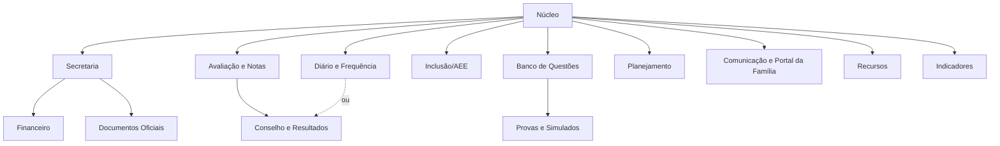

# 4. Módulos e planos — venda por assinatura de módulos

> **Resumo.** O Áxis passa a ser vendido como um **Núcleo obrigatório** mais **módulos** que cada escola contrata (ex.: Diário e Frequência, Avaliação e Notas, Gerador de Provas). Este documento propõe o catálogo de 13 módulos, o que cada um inclui (telas, rotas, tabelas), as **dependências** entre eles (ex.: Gerador de Provas exige Banco de Questões) e — o mais importante — **o que o sistema faz quando um módulo está desligado** (ex.: escola com diário mas sem notas: a frequência continua, o boletim mostra só frequência).
> Hoje o módulo só esconde o item do menu; a proposta é uma **garantia no servidor**: uma função `exigirModulo()` chamada em toda rota de API, server action e página do módulo, mais um **teste automático que varre todos os arquivos de rota e falha** se algum arquivo de um módulo não tiver a checagem (no estilo do teste de isolamento).
> Os **planos** deixam de ser um enum fixo (BASICO/PRO/ENTERPRISE) e viram **pacotes de módulos** guardados no banco, com add-ons, limites (estudantes, usuários) e período de teste.
> Ao desligar um módulo, **nenhum dado é apagado**: ele fica **somente leitura** por um período e depois só exportável. Preços não são definidos aqui (decisão D-11).

---

## 4.1 Princípios

1. **Núcleo funciona sozinho.** Com só o Núcleo, a escola cadastra estrutura, pessoas e turmas, e usa o portal básico. Nenhum módulo é obrigatório além dele.
2. **Módulo depende só "para baixo".** Um módulo pode usar dados do Núcleo e de módulos de que depende; o Núcleo **nunca** depende de um módulo (regra que já está no plano multi-tenant, seção 7.5).
3. **Desligar não apaga.** Dados ficam guardados; o acesso vira somente leitura e depois só exportação.
4. **Servidor decide.** Menu escondido é conveniência; a regra está em `exigirModulo()`.
5. **Módulo ≠ permissão.** Módulo responde "a escola contratou?"; permissão responde "esta pessoa pode?". As duas checagens são necessárias e independentes.

---

## 4.2 Catálogo proposto

| ID | Nome comercial (sugestão) | Inclui (telas · rotas · tabelas) | Depende de |
|---|---|---|---|
| `NUC` | **Núcleo Áxis** (obrigatório) | Estrutura (cursos, séries, turmas, componentes, ano letivo, calendário, tempos de aula), pessoas (estudante e responsável — ficha básica), usuários e papéis, configurações, identidade visual, painel inicial, mensagens internas simples, auditoria, portal com dados cadastrais · `api/turmas`, `cursos`, `disciplinas`, `areas`, `usuarios`, `config`, `auth` · `Escola`, `Pessoa`, `Estudante`, `Turma`, `AnoLetivo`, `Usuario`, `VinculoPapel`... | — |
| `SEC` | **Secretaria Escolar** | Ficha completa do estudante (documentos, saúde, transporte, autorizações), responsáveis completos, matrícula/rematrícula, enturmação, remanejamento, transferências, abandono, fechamento do ano, importação guiada, ocorrências, campos personalizados e formulário de matrícula · `api/estudantes/**`, `upload-csv`, `ocorrencias` · `Matricula`, `Enturmacao`, `Movimentacao`, `Autorizacao`, `CampoPersonalizado` | NUC |
| `DIA` | **Diário de Classe e Frequência** | Horário da turma, chamada, diário (conteúdo ministrado), justificativas, infrequência, busca ativa · `dashboard/chamada/**`, `frequencia`, `turmas/[id]/horario` · `HorarioAula`, `Aula`, `Falta`, `Justificativa`, `ObservacaoChamada` | NUC |
| `NOT` | **Avaliação e Notas** | Esquemas de avaliação, lançamento de notas, avaliações do professor, recuperação, boletim · `api/notas/**`, `esquemas-avaliacao`, `boletim` · `EsquemaAvaliacao`, `NotaFinal`/`ResultadoComponente`, `NotaUnidade`... | NUC |
| `RES` | **Conselho de Classe e Resultados** | Conselho, resultados finais, ata de resultados, relatórios de turma/status, fechamento pedagógico · `api/conselho-classe`, `relatorio/**`, `dashboard/resultados`, `conselho-classe` | NOT (resultado por nota) **ou** DIA (escola sem nota que aprova por frequência/parecer) |
| `AEE` | **Inclusão e AEE** | Fichas AEE, PEI, recursos de avaliação, ciência dos professores, turmas de AEE · `api/estudantes/[id]/aee/**`, `dashboard/aee` · `FichaAEE`, `PlanoAEE`, `RecursoAvaliacao` | NUC (cadastro de deficiência para o Censo fica no NUC/SEC; o **acompanhamento** é o módulo) |
| `QST` | **Banco de Questões** | Questões, aprovação pela coordenação, duplicidade · `api/questoes/**` · `Questao` | NUC |
| `PRV` | **Gerador de Provas e Simulados** | Montagem de provas, PDF, simulados, notas de simulado, análise de risco por simulado · `api/provas/**`, `simulados/**` · `Prova`, `NotaSimulado` | QST |
| `PLA` | **Planejamento** | Planos de ensino, matriz curricular (edição avançada; a matriz básica que gera os componentes da turma fica no NUC), ligação plano ↔ diário · `api/planos/**`, `matriz/**` · `PlanoEnsino`, `MatrizCurricular` | NUC (ligação com diário se DIA) |
| `COM` | **Comunicação e Portal da Família** | Portal do responsável (vários filhos), comunicados por turma/série, aviso de falta no dia, autorizações com aceite digital, notificações (e-mail/push; WhatsApp/SMS como add-on por custo) · `dashboard/mensagens` (comunicados), `portal/**` · `Comunicado`, `Notificacao` | NUC (mostra notas se NOT, frequência se DIA) |
| `REC` | **Recursos e Espaços** | Laboratórios, salas, reservas · `api/laboratorios/**` · `Espaco`, `Reserva` | NUC |
| `FIN` | **Financeiro Escolar** | Contratos, mensalidades, descontos/bolsas, boletos/Pix, inadimplência — **escolas privadas** · `api/financeiro/**` · `ContratoEducacional`, `Cobranca` | SEC (precisa de matrícula e responsável financeiro) |
| `IND` | **Indicadores** | Painéis de aprovação, frequência, evasão por turma/componente/ano; alerta precoce; visão da rede · `relatorios/professores-pendentes`, painéis | NUC (cada painel aparece conforme os módulos de dados: DIA, NOT) |
| `DOC` | **Documentos Oficiais** | Modelos de documentos, emissão com QR e validação pública, histórico escolar, declarações, exportação para o Censo · `documentos/**`, `censo/**` · `ModeloDocumento`, `DocumentoEmitido` | SEC (histórico também usa NOT e DIA quando ativos) |

> **Observação sobre o "Banco de Questões" e o "Gerador":** hoje são dois itens de catálogo (`banco-questoes` e `provas`). A proposta os mantém como dois módulos para permitir vender o banco sozinho (escolas que só querem organizar questões) — mas é decisão comercial (D-01).

### 4.2.1 Grafo de dependências



Regras:
- Ao **contratar** um módulo, o sistema exige (ou oferece) os de que ele depende.
- Ao **desligar** um módulo do qual outro depende, o dependente também entra em somente leitura (ex.: desligar QST deixa PRV em leitura).
- Dependências **"suaves"** (setas pontilhadas e "conforme os módulos") não bloqueiam: só escondem partes da tela.

---

## 4.3 Comportamento com módulo DESLIGADO

| Módulo desligado | O que some | O que continua | Exemplo concreto |
|---|---|---|---|
| `SEC` | Ficha completa, movimentações pela tela própria, campos personalizados, importação guiada | Cadastro básico do estudante e do responsável (Núcleo), enturmação simples (colocar aluno na turma) | Escola pequena só com Diário: a direção cadastra alunos com nome, data de nascimento, responsável e turma |
| `DIA` | Chamada, diário, horário, justificativas | Notas (se NOT); boletim **sem coluna de frequência** e sem "reprovado por falta"; o esquema de avaliação esconde a seção de frequência | Escola que só usa notas (ex.: a frequência é lançada no sistema da rede) |
| `NOT` | Lançamento de notas, esquemas, recuperação, boletim de notas | **Diário de classe e frequência continuam**; portal mostra frequência; resultado (se RES via DIA) por frequência/parecer | "Gestão pedagógica sem notas": escola de educação infantil ou rede que lança notas em outro sistema |
| `RES` | Conselho, ata, relatórios de resultados | Notas e boletim por etapa (NOT); situação final fica "em aberto" | Escola que fecha o ano fora do Áxis |
| `AEE` | Ficha AEE, PEI, recursos de avaliação, ciência dos professores | Registro de deficiência e recursos para o Censo (cadastro, NUC/SEC); o alerta de saúde do cadastro (ex.: alergia grave) continua aparecendo para o professor | Escola que faz o AEE em outra instituição: só informa a deficiência para o Censo |
| `QST` | Banco de questões | — (PRV também fica em leitura) | — |
| `PRV` | Gerador, simulados | Banco de questões (se QST) | — |
| `PLA` | Planos de ensino | Matriz básica do Núcleo (para criar componentes da turma); diário sem o vínculo "plano previsto × conteúdo dado" | — |
| `COM` | Portal da família (responsável), comunicados por grupo, notificações | Portal do **estudante** básico (dados cadastrais e documentos), mensagens internas da equipe | Decisão D-12: portal do estudante com notas é parte de NOT ou de COM? |
| `REC` | Reservas | — | — |
| `FIN` | Cobrança | Responsável financeiro continua cadastrado | — |
| `IND` | Painéis analíticos | Relatórios operacionais de cada módulo | — |
| `DOC` | Emissão por modelo com QR, histórico, Censo | Impressão simples de listas e boletins de cada módulo (sem validade oficial) | — |

**Regra geral de tela**: cada componente de tela que mostra dado de outro módulo pergunta `moduloAtivo('NOT')` (no servidor, ao montar a página) e esconde a parte — o padrão já usado hoje para montar o menu (`modulosVisiveis`).

---

## 4.4 Garantia no servidor: `exigirModulo()`

### 4.4.1 Estados de um módulo para uma escola

| Estado | Leitura | Escrita | Menu |
|---|---|---|---|
| `ATIVO` (inclui período de teste) | sim | sim | aparece |
| `SOMENTE_LEITURA` (desligado há pouco, inadimplência, fim de teste) | sim | **não** (403 com mensagem clara) | aparece com selo "somente leitura" |
| `INATIVO` | não (só exportação pelo painel de dados) | não | não aparece (ou aparece como "conheça" — decisão comercial) |

### 4.4.2 API proposta (esboço — não implementado)

```ts
// src/lib/modulos/guarda.ts  (server-only)
export type ModuloId = 'NUC' | 'SEC' | 'DIA' | 'NOT' | 'RES' | 'AEE' | 'QST' | 'PRV' | 'PLA' | 'COM' | 'REC' | 'FIN' | 'IND' | 'DOC'
export type Acesso = 'leitura' | 'escrita'

export class ModuloIndisponivel extends Error {
  constructor(public modulo: ModuloId, public estado: 'INATIVO' | 'SOMENTE_LEITURA') { super(...) }
}

/** Lança ModuloIndisponivel se a escola não pode usar o módulo com esse acesso. Cache por requisição (React cache). */
export async function exigirModulo(escolaId: string, modulo: ModuloId, acesso: Acesso = 'escrita'): Promise<void>

/** Para montar telas: não lança, devolve o estado. */
export async function estadoModulo(escolaId: string, modulo: ModuloId): Promise<'ATIVO' | 'SOMENTE_LEITURA' | 'INATIVO'>

// Envoltórios para não depender de lembrar a chamada:
export function rotaDoModulo(modulo: ModuloId, handlers: { GET?: H; POST?: H; PUT?: H; PATCH?: H; DELETE?: H }): typeof handlers
//   GET => exige 'leitura'; demais => 'escrita'; converte ModuloIndisponivel em 403 { codigo: 'MODULO_INDISPONIVEL', modulo, estado }

export function acaoDoModulo<A extends unknown[], R>(modulo: ModuloId, acesso: Acesso, acao: (...a: A) => Promise<R>): (...a: A) => Promise<R | { erro: string }>

export async function paginaDoModulo(modulo: ModuloId): Promise<void>  // redireciona para /dashboard/modulo-indisponivel?m=...
```

Uso numa rota (como ficaria `api/notas/lancar/route.ts`):

```ts
export const { POST } = rotaDoModulo('NOT', {
  async POST(req) { /* código atual, sem mudança */ },
})
```

Pontos de desenho:
- **Ordem das checagens**: sessão → escola (já existe) → `exigirModulo` → permissão (`can`) → regra de negócio. Módulo antes da permissão para a mensagem ser "sua escola não contratou" e não "você não pode".
- **Rotas compartilhadas** (ex.: `boletim/[id]/pdf` usa NOT e mostra DIA): exigem o módulo **principal** (NOT) e consultam `estadoModulo('DIA')` para incluir ou não a frequência.
- **Núcleo**: rotas do Núcleo usam `rotaDoModulo('NUC', ...)` mesmo sendo sempre ativo — isso torna a marcação **explícita** e o teste abaixo simples (todo arquivo declara a que módulo pertence).
- **Escola suspensa** continua tratada no `proxy.ts` (já existe); `exigirModulo` cuida só do módulo.
- **Cache**: o estado dos módulos é lido uma vez por requisição (`cache()` do React, como `escolaDaRequisicao`), sem cache entre requisições — mudança de assinatura vale na hora.

### 4.4.3 Teste automático de cobertura (no estilo de `isolamento-escolas.test.ts`)

Dois testes complementares:

**(a) Teste estático — `src/lib/modulos/cobertura-modulos.test.ts`**

1. Lista com `glob` todos os `src/app/api/**/route.ts`, `src/app/**/actions.ts` e `src/app/dashboard/**/page.tsx`.
2. Um mapa único `src/lib/modulos/mapa-rotas.ts` diz a que módulo pertence cada prefixo (`'api/notas/' → 'NOT'`, `'dashboard/chamada/' → 'DIA'`, `'api/plataforma/' → 'PLT'`...). **Arquivo sem prefixo no mapa = teste falha** ("rota nova sem módulo definido").
3. Para cada arquivo, o teste lê o código-fonte e exige `rotaDoModulo('<ID>'`, `acaoDoModulo('<ID>'` ou `paginaDoModulo('<ID>'` com o **mesmo ID do mapa**. Exceções explícitas e comentadas numa lista (`auth/[...nextauth]`, `manifest`, páginas públicas) — a lista de exceções também é conferida (exceção sem arquivo correspondente = falha, para não acumular lixo).
4. Mensagem de erro clara: `api/provas/route.ts pertence a PRV mas não chama rotaDoModulo('PRV', ...)`.

**(b) Teste de comportamento — `src/lib/modulos/modulos-desligados.test.ts`**

1. Cria uma escola de teste com **todos os módulos INATIVOS** (só NUC) e outra com tudo em **SOMENTE_LEITURA**.
2. Para cada rota de cada módulo (lista gerada do mapa), chama o handler real com sessão de direção (para não esbarrar em permissão) e espera **403 `MODULO_INDISPONIVEL`** — em leitura, GET passa e escrita falha.
3. Server actions: chama a ação exportada e espera `{ erro }`.
4. Confere que **nenhum dado mudou** no banco (igual ao bloco final do teste de isolamento).

O teste (a) é rápido e roda sempre na CI; o (b) usa o banco de teste, como o de isolamento.

### 4.4.4 Migração do que existe

- `MODULOS` em `src/lib/modules.ts` continua sendo o **catálogo de menu** (ícone, rota, grupo), mas cada item passa a ter `moduloId: ModuloId` em vez de `planoMinimo`.
- `getModulosAtivos(escolaId, plano)` passa a ler `Assinatura` + `AssinaturaModulo` (abaixo) em vez de `plano` + `EscolaModulo`.
- As 3 checagens que já existem (`questoes` POST, `financeiro`, página `questoes`) viram `rotaDoModulo`/`paginaDoModulo`.
- O toggle do banco de questões em `api/config` sai da tela da escola e vai para o painel da plataforma (a escola não liga módulo que não contratou).

---

## 4.5 Planos, add-ons, limites e teste grátis

### 4.5.1 Modelo de dados

| Tabela | Campos principais |
|---|---|
| `Plano` (catálogo comercial, da plataforma) | código, nome comercial, descrição, ativo para venda, ordem; limites padrão (estudantes, usuários da equipe, armazenamento) |
| `PlanoModulo` | plano × módulo incluído |
| `Assinatura` (uma vigente por escola, ou por mantenedora) | escola/mantenedora, plano, situação (teste, ativa, inadimplente, suspensa, cancelada), início, fim, **fim do teste**, limites contratados (sobrescrevem os do plano), ciclo de cobrança, observações |
| `AssinaturaModulo` | add-ons e exceções: módulo, origem (plano, add-on, cortesia, teste), estado (`ATIVO`/`SOMENTE_LEITURA`/`INATIVO`), início, fim |
| `HistoricoAssinatura` | toda mudança (quem, quando, de/para) — base para suporte e cobrança |

Isso substitui `PlanoTipo` (enum), `planoMinimo` e `EscolaModulo`. Backfill: cada escola atual recebe uma `Assinatura` com o plano equivalente (BASICO/PRO/ENTERPRISE viram três `Plano` iniciais com os mesmos módulos de hoje) — resultado de `getModulosAtivos` **idêntico** antes e depois (teste de equivalência).

### 4.5.2 Pacotes sugeridos (sem preço)

Exemplos para discussão (decisão D-11). Os nomes são provisórios.

| Pacote | Para quem | Módulos |
|---|---|---|
| **Essencial** | Escola que quer sair do papel/planilha no dia a dia | NUC + DIA |
| **Pedagógico** | Escola pública que precisa de diário, notas e resultados | NUC + DIA + NOT + RES + AEE |
| **Escola Completa (pública)** | Escola/rede pública | Pedagógico + SEC + DOC + COM + IND |
| **Escola Completa (privada)** | Escola particular | Pedagógico + SEC + DOC + COM + FIN |
| **Add-ons** | Qualquer pacote | QST, PRV, PLA, REC, IND, COM, canal WhatsApp/SMS (custo variável), armazenamento extra |

### 4.5.3 Limites

| Limite | Recomendação | Por quê |
|---|---|---|
| **Estudantes ativos** (matrículas "cursando" no ano letivo aberto) | **Métrica principal** de preço | É como o mercado escolar pensa o tamanho da escola; não pune a escola por cadastrar professores |
| Usuários da equipe | Sem limite rígido, ou limite alto | O limite atual (15/50/∞ staff) incentiva compartilhar senha, ruim para segurança e auditoria |
| Responsáveis/estudantes no portal | Sem limite | Já é assim |
| Armazenamento (anexos, fotos, PDFs) | Limite por plano | Custo real de nuvem |
| Notificações pagas (SMS/WhatsApp) | Por pacote de mensagens | Custo variável |

Comportamento ao ultrapassar: **aviso** à direção e à plataforma a partir de 90%; ao passar de 100%, **não bloqueia** matrícula (bloquear matrícula de aluno é inaceitável no meio do ano) — gera cobrança de excedente ou conversa comercial (decisão D-13).

### 4.5.4 Período de teste

- Teste por **escola** (todos os módulos do pacote escolhido, ou "tudo liberado") por N dias (D-13), com dados reais.
- Fim do teste sem contratação: módulos vão para **somente leitura** por 30 dias, depois `INATIVO`; os dados ficam guardados pelo prazo de retenção (D-09) e podem ser exportados.
- **Teste de módulo** para escola já cliente (ex.: experimentar o Gerador de Provas por 30 dias) via `AssinaturaModulo.origem = TESTE`.

### 4.5.5 O que acontece com os dados quando o módulo é desligado

| Momento | Situação | Escola consegue |
|---|---|---|
| Dia 0 (desligado, rebaixado ou fim do teste) | `SOMENTE_LEITURA` | Ver tudo, imprimir, exportar; **não** cria nem altera |
| Após o período de leitura (sugestão: 90 dias, D-02) | `INATIVO` | Exportar pelo painel "Meus dados" (CSV/PDF); telas fora do menu |
| Religou | `ATIVO` | Tudo volta como estava |
| Contrato encerrado | Assinatura cancelada | Exportação completa por período definido em contrato; depois, **anonimização/exclusão** — exceto o que a escola tem obrigação legal de guardar, que é **entregue** à escola (histórico, atas) antes de apagar |

**Nunca**: apagar dados ao desligar um módulo; esconder dados de **vida escolar oficial** (histórico, atas, resultados finais já fechados) — esses continuam consultáveis em leitura **enquanto a escola for cliente**, mesmo com o módulo inativo, porque a escola é obrigada a emiti-los a qualquer momento. (Recomendação; decisão D-02.)

---

## 4.6 Painel da plataforma (dona do Áxis)

O painel `/dashboard/plataforma` (já existe) passa a ter: assinatura de cada escola, módulos e estados, limites e uso (estudantes ativos, armazenamento), histórico de mudanças, início/fim de teste, e o botão "colocar em somente leitura". A cobrança automática (gateway de pagamento) é um passo posterior (roteiro, fase 9).
