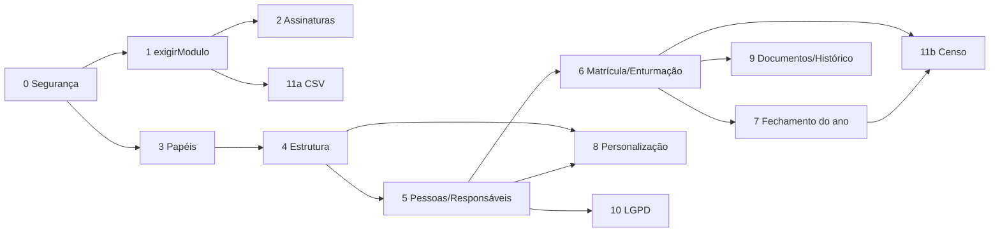

# 5. Roteiro de migração — chegar lá sem quebrar a CETEP

> **Resumo.** A CETEP usa o Áxis todos os dias; nenhuma fase pode parar a escola ou perder dados. Por isso o caminho é feito em **12 fases pequenas**, cada uma com mudanças **aditivas** no banco (cria o novo ao lado do velho), **backfill** (cópia dos dados atuais para o formato novo), um **teste de equivalência** (o sistema dá o mesmo resultado antes e depois) e só no fim a remoção do que ficou velho.
> A ordem é: **(0)** fechar as lacunas de segurança achadas no inventário; **(1)** garantia de módulo no servidor; **(2)** planos e assinaturas no banco; **(3)** papéis e permissões; **(4)** ano letivo e estrutura (etapas, séries, componentes); **(5)** pessoas, estudante completo e responsáveis; **(6)** matrícula por ano, enturmação e movimentações; **(7)** fechamento do ano e rematrícula; **(8)** personalização; **(9)** documentos oficiais e histórico; **(10)** LGPD operacional; **(11)** exportações (planilhas e Censo); depois, módulos novos (portal da família completo, financeiro, indicadores).
> Cada fase diz se pode ser uma **sessão de implementação independente na nuvem** e o tamanho (P, M, G). As fases 0–3 não dependem de decisões de produto difíceis e podem começar já; as fases 5–7 dependem das decisões D-03 a D-06 (documento 6).
> **Janela crítica:** a matrícula por ano (fase 6) e o fechamento do ano (fase 7) idealmente entram **antes da rematrícula de 2027** da CETEP, ou então só depois do fim do 1º trimestre de 2027 — nunca no meio do fechamento do ano.

---

## 5.1 Regras que valem para todas as fases

1. **Migrations aditivas e separadas**: criar tabela/coluna nova (anulável) → backfill → conferência → tornar obrigatória → (fase seguinte) remover o antigo. Nada de uma migration gigante. É a mesma disciplina usada no multi-tenant e na troca de `nota1/2/3`.
2. **Backfill como script idempotente** (rodar duas vezes não duplica nada), em `prisma/backfill/<fase>.ts`, testado contra uma cópia do banco da CETEP antes da produção.
3. **Teste de equivalência** para toda troca de "motor": permissões (`can` velho × novo), módulos ativos (`getModulosAtivos` velho × novo), notas/frequência/situação (motor lendo do modelo velho × novo) — com os dados reais da CETEP numa cópia.
4. **Isolamento primeiro**: toda tabela nova com `escolaId` entra no `isolamento-escolas.test.ts` na mesma fase.
5. **Leitura dupla, escrita única**: durante a transição, o código escreve no modelo novo e lê do novo com *fallback* para o velho quando o novo ainda não existe — e a fase só termina quando o fallback não é mais usado.
6. **Regras puras continuam em `src/lib/services`**; telas e rotas só orquestram.
7. **Backup verificado** antes de cada migration de produção.
8. **Sem mudança de rotina para o professor** sem aviso: cada fase lista as telas afetadas para comunicação à escola.

Tamanho estimado de sessão: **P** ≈ meio dia de trabalho de uma sessão; **M** ≈ uma sessão longa; **G** ≈ precisa ser dividida em 2–3 sessões (as divisões estão sugeridas).

---

## 5.2 Fases

### Fase 0 — Lacunas de segurança e preparação (P)

- **Objetivo**: corrigir o que o inventário achou antes de mexer na estrutura.
- **Mudanças**: (a) papel exigido nos PDFs `relatorio/resultados/[id]`, `relatorio/status/[id]`, `relatorio/turma/[id]/disciplina/[disciplinaId]`; (b) papel na action `reportarEstudanteFaltante`; (c) checagem completa do módulo nas rotas `questoes/[id]` (já que o POST confere); (d) remover `api/public/v1/register` (código morto); (e) trocar os `@default(2026)` por "ano letivo atual da escola" no código que cria registros (o default do schema só sai na fase 4).
- **Schema**: nenhum.
- **Telas afetadas**: nenhuma visível.
- **Riscos**: algum professor usar hoje um PDF que passará a ser barrado → conferir quem acessa (log) e manter acesso de equipe.
- **Testes**: novos casos no bloco "aluno do portal" do `isolamento-escolas.test.ts` para os 3 PDFs e a action.
- **Sessão independente?** Sim.

### Fase 1 — Garantia de módulo no servidor (M)

- **Objetivo**: módulo desligado passa a ser barrado no servidor, não só no menu (documento 4.4).
- **Mudanças**: `src/lib/modulos/{guarda.ts,mapa-rotas.ts}` com `ModuloId`, `exigirModulo`, `rotaDoModulo`, `acaoDoModulo`, `paginaDoModulo`; aplicar em **todas** as 63 rotas, 14 arquivos de actions e páginas do dashboard; nesta fase os estados vêm do `getModulosAtivos` atual (ativo/inativo; "somente leitura" chega na fase 2). Itens do catálogo `MODULOS` ganham `moduloId`.
- **Schema**: nenhum.
- **Telas**: nova página "módulo indisponível".
- **Riscos**: rota compartilhada classificada no módulo errado e escola perder acesso a algo que usa → o mapa começa conservador (rotas de uso misto ficam em NUC) e a CETEP é ENTERPRISE (tudo ligado), então nada muda para ela.
- **Testes**: teste estático de cobertura + teste de comportamento com escola sem módulos (4.4.3).
- **Sessão independente?** Sim. Pode dividir em 1a (infra + teste estático + API) e 1b (actions + páginas).

### Fase 2 — Planos e assinaturas no banco (M)

- **Objetivo**: planos como pacotes de módulos, add-ons, limites, teste grátis, estado somente leitura (documento 4.5).
- **Schema**: `Plano`, `PlanoModulo`, `Assinatura`, `AssinaturaModulo`, `HistoricoAssinatura`.
- **Backfill**: três `Plano` (Básico/Pro/Enterprise) com os módulos de hoje; cada `Escola` ganha `Assinatura` do seu `plano`; cada `EscolaModulo` vira `AssinaturaModulo` (origem "exceção"). `Escola.status = TRIAL` → `Assinatura.situacao = TESTE` com fim a definir.
- **Equivalência**: `getModulosAtivos` novo = velho para todas as escolas.
- **Depois**: remover `Escola.plano`, `PlanoTipo`, `EscolaModulo`, `planoMinimo` e o toggle de `api/config`.
- **Telas**: painel da plataforma (assinatura e módulos por escola); selo "somente leitura".
- **Limites**: troca de "usuários staff" para "estudantes ativos" **só depois** da fase 6 (precisa de matrícula); até lá mantém o limite atual.
- **Riscos**: baixos — CETEP continua com tudo.
- **Sessão independente?** Sim, após a fase 1. **Depende de** D-01/D-11 apenas para os nomes dos pacotes novos (pode usar os três atuais).

### Fase 3 — Papéis e permissões (G → 3a, 3b, 3c)

- **Objetivo**: trocar booleanos por papéis com permissões e escopo (documento 2.5), sem mudar quem vê o quê.
- **3a (M)** — Schema `Papel`, `PapelPermissao`, `VinculoPapel`; lista fechada de permissões em `src/lib/permissoes.ts`; papéis de sistema (Direção, Secretaria, Coordenação, Professor, AEE, Estudante, Responsável). Backfill dos booleanos conforme tabela 2.5.3. `can()` passa a ler papéis e mantém as 5 ações antigas como atalhos. **Teste de equivalência** com todos os usuários da CETEP × todas as ações antigas.
- **3b (M)** — Migrar as ~26 checagens inline (`isSuperuser || isDirecao`...) para `can(..., 'recurso.acao')`. Tela de usuários com papéis (em vez de caixas de seleção). Professor: escopo derivado de `disciplinasPermitidas`/`turmasPermitidas` (que viram `Docencia` na fase 4).
- **3c (P)** — Conta da plataforma fora da escola (usuário de plataforma sem `escolaId` ou numa "escola-plataforma" técnica); remover booleanos de `User` e da sessão (`next-auth.d.ts`).
- **Telas**: Usuários (novo editor de papéis); nada muda para o professor.
- **Riscos**: alguém perder acesso → equivalência obrigatória e período com os dois modelos lado a lado.
- **Sessão independente?** Sim, cada subfase. Papéis novos (Secretaria, Coordenação) já ficam disponíveis para a CETEP usar.

### Fase 4 — Ano letivo e estrutura da escola (G → 4a, 4b)

- **Objetivo**: estrutura no padrão do documento 2.4.
- **4a (M)** — `AnoLetivo` (evolução de `PeriodoLetivo` + `GlobalConfig.anoLetivoAtual` → `AnoLetivo.atual`/situação); `Turma.anoLetivoId` (backfill de `Turma.anoLetivo`); catálogo `EtapaEnsino` (seed nacional); `Serie` por curso (backfill a partir de `Turma.serie` distinta por curso, "1" → "1ª série"); `Turno` enum (backfill normalizando o texto, como já é feito em `TempoAula`); `Curso.modalidade` texto → modalidade do catálogo (de-para revisado manualmente para a CETEP: EPI → técnico integrado, PROEJA → EJA integrada etc.). Remover `GlobalConfig` e os `@default(2026)`.
- **4b (G)** — `ComponenteCurricular` (catálogo da escola) + `TurmaComponente`: backfill agrupando `Disciplina` por nome normalizado (o "Matemática" de 40 turmas vira 1 componente e 40 ofertas); `abreviacao` preenchida com o dicionário que hoje está fixo nos PDFs; `Disciplina` vira `TurmaComponente` **mantendo o mesmo id** (renomear tabela/modelo em vez de copiar, para não mexer nas chaves de `NotaFinal`, `Aula`, `HorarioAula`, `AvaliacaoDisciplina`); `MatrizCurricular` ganha `escolaId`, vigência e `MatrizItem` com `componenteId`; `Docencia` substitui `disciplinasPermitidas`. Remover texto legado de `HorarioAula` e adicionar vigência.
- **Telas**: Turmas (série/turno por lista), Disciplinas → Componentes curriculares, Matriz, relatórios (abreviação vem do cadastro).
- **Riscos**: nomes de disciplina com grafias diferentes ("Lingua Portuguesa" × "LÍNGUA PORTUGUESA") → relatório de agrupamento para revisão humana antes de confirmar.
- **Sessão independente?** Sim (4a antes de 4b). Depende de **D-06** (etapas atendidas) só para o seed do catálogo — o catálogo completo pode entrar mesmo sem decisão.

### Fase 5 — Pessoas, estudante completo e responsáveis (G → 5a, 5b, 5c)

- **Objetivo**: cadastro de pessoas do documento 2.2.
- **5a (M)** — `Pessoa`, `DocumentoPessoa`, `ContatoPessoa`, `EnderecoPessoa`; `Estudante.pessoaId` (backfill: uma `Pessoa` por estudante com nome, data de nascimento, sexo); campos do Censo no estudante (transporte, código INEP); `SaudeEstudante`, `DeficienciaEstudante`, `RecursoAvaliacao` (backfill: `AEEProfile.precisaProvaAdaptada/SalaEspecial` → recursos; `AEEProfile` vira `FichaAEE`). Ficha do estudante em abas (Dados, Documentos, Endereço, Responsáveis, Saúde, Inclusão, Vida escolar). **Registro de leitura** de saúde/AEE já nesta fase (LGPD).
- **5b (M)** — `VinculoResponsavel` + tela de responsáveis; backfill de `AEEProfile.contatoNome/contatoTelefone` como responsável "contato de emergência" a confirmar; importação de responsáveis por planilha (a CETEP provavelmente tem os dados no SIGEduc/planilhas).
- **5c (M)** — Papel **Responsável** e Portal da Família: login do responsável vendo vários dependentes; `User.estudanteId` → vínculo de papel Estudante pela pessoa. Portal do estudante continua funcionando.
- **Schema**: aditivo; `User.estudanteId` sai só ao final de 5c.
- **Telas**: Estudantes (ficha nova), Portal (seletor de dependente), Usuários.
- **Riscos**: LGPD (coleta de dados sensíveis sem termo) → termo de ciência/consentimento entra em 5b junto com autorizações; dados da CETEP incompletos → todos os campos novos opcionais, painel de "pendências de cadastro".
- **Depende de**: D-05 (pessoa por escola ou por rede), D-08 (idade de login do estudante), D-09 (retenção).
- **Sessão independente?** Sim, em sequência.

### Fase 6 — Matrícula por ano, enturmação e movimentações (G → 6a, 6b)

- **Objetivo**: vida escolar do documento 2.3.
- **6a (G)** — `Matricula`, `Enturmacao`, `Movimentacao`, `EstudoAnterior`. **Backfill**:
  1. Para cada `Estudante`, uma `Matricula` no ano da sua `Turma` atual (curso/série/turno da turma), situação `CURSANDO` (ou de acordo com `Estudante.status`: `REMOVIDO_VIA_VARREDURA` → `CANCELADA`/revisão manual) e uma `Enturmacao` aberta.
  2. Se `turmaAnteriorId` existe: `Matricula` do ano da turma anterior, com situação calculada a partir dos `NotaFinal` daquela turma pelo motor atual (aprovado, aprovado pelo conselho, dependência, reprovado...) e `Enturmacao` encerrada; marcar como **"reconstruída na migração"**.
  3. `NotaFinal.matriculaId` (backfill pela turma da disciplina × matrículas do estudante) — a chave antiga continua por enquanto.
  4. `Falta`/`Justificativa` continuam por estudante; a leitura de frequência passa a filtrar pelas datas da enturmação.
- **6b (M)** — Telas de secretaria: matricular, enturmar (individual e em lote), remanejar, transferir (interna/externa), registrar abandono; lista de chamada por data de enturmação; notas acompanham o remanejamento.
- **Equivalência**: boletins, relatórios e frequência de todas as turmas da CETEP **idênticos** antes e depois do backfill.
- **Riscos**: o mais alto do roteiro — mexe na chave de leitura de notas e frequência. Mitigação: leitura dupla com comparação automática em ambiente de cópia por uma semana de uso real antes de virar.
- **Janela**: **não** executar entre o fim da última unidade e a rematrícula (dezembro–fevereiro na CETEP). Decisão D-14.
- **Depende de**: D-03, D-06.
- **Sessão independente?** 6a em 2 sessões (schema+backfill; leitura nova+equivalência); 6b em 1.

### Fase 7 — Fechamento do ano e rematrícula (M)

- **Objetivo**: substituir "promover turma" pelo fluxo de 2.3.4 (situação calculada → revisão → conselho → encerramento → rematrícula na série seguinte → enturmação em lote).
- **Schema**: `Serie.proximaSerieId`; situação gravada em `Matricula`/`ResultadoComponente`; `AnoLetivo.situacao`.
- **Telas**: Secretaria → Fechamento do ano; Turmas → Enturmação em lote. Remover `turmas/[id]/promover`, `admin/merge-turmas`, `admin/unificar-turmas` (ferramentas do projeto original), `Estudante.turmaId`/`turmaAnteriorId`.
- **Riscos**: primeira virada de ano real com o fluxo novo → simular em cópia com os dados de 2026 antes.
- **Sessão independente?** Sim, após a 6.

### Fase 8 — Personalização (G → 8a, 8b)

- **8a (M)** — `Nomenclatura` + função `termo()`; situações com rótulo/sigla configuráveis; assistente de implantação de nova escola (etapas oferecidas → cursos, séries, esquemas sugeridos).
- **8b (M)** — `CampoPersonalizado` + `camposExtras` (JSONB) + validador puro; `ModeloFormulario` para matrícula e atualização cadastral; pendências do Censo no formulário.
- **Depende de**: D-10.
- **Sessão independente?** Sim.

### Fase 9 — Documentos oficiais e histórico escolar (G → 9a, 9b)

- **9a (M)** — `ModeloDocumento` (versões), gerador HTML→PDF com identidade da escola, `DocumentoEmitido` com código + QR e página pública de verificação; declarações (matrícula, frequência, transferência, conclusão) e boletim oficial.
- **9b (M)** — Histórico escolar (matrículas encerradas + `EstudoAnterior`), ata de resultados finais, ficha individual. Os PDFs atuais (`relatorio/**`, `boletim`) passam a usar o gerador.
- **Depende de**: D-17 (o que a página pública mostra), fase 6 (histórico).
- **Sessão independente?** Sim.

### Fase 10 — LGPD operacional (M)

- Autorizações com aceite pelo portal e modelos de texto; termo de ciência; exportação dos dados do titular; anonimização ao fim do prazo (job agendado); política de retenção por tipo; tela "Privacidade" para a direção (quem acessou dados sensíveis); registro de finalidade nos campos sensíveis.
- **Depende de**: D-09.
- **Sessão independente?** Sim. (Registro de leitura sensível já entra na fase 5.)

### Fase 11 — Exportações: planilhas e Censo (M + M)

- **11a (P/M)** — Exportação CSV/XLSX das listas (estudantes, turmas, notas, frequência) com colunas escolhidas, respeitando permissões e marcando sensíveis. **Pode ser antecipada** (depois da fase 1), pois não depende do modelo novo — mas deve ser refeita sobre `Matricula` após a fase 6.
- **11b (M)** — Exportação para o Educacenso por versão de leiaute (`censo/<ano>.ts`), com relatório de pendências por aluno/turma/profissional antes de gerar o arquivo. Depende das fases 4–6 e do leiaute oficial do ano.
- **Sessão independente?** Sim.

### Depois da fase 11 — Módulos novos

| Módulo | Pré-requisitos | Tamanho |
|---|---|---|
| Comunicação completa (comunicados por grupo, aviso de falta no dia, notificações e-mail/push; WhatsApp/SMS como add-on) — separar `Message` em `Comunicado` e `Chamado` | Fases 5c e 2 | G |
| Indicadores (painéis, alerta precoce/busca ativa, visão de rede) | Fases 6 e 7 | M |
| Financeiro (escolas privadas) | Fase 5b (responsável financeiro), D-16 | G |
| Planejamento ligado ao diário (plano previsto × conteúdo dado) | Fase 4 | M |
| Rede/mantenedora (herança de configurações, painel consolidado) | Fases 2, 3, 8; D-04 | G |
| Conceito/parecer descritivo (educação infantil, anos iniciais) | Fase 4; D-06 | M |
| Cobrança automática das assinaturas (gateway) | Fase 2 | M |

---

## 5.3 Funcionalidades já planejadas, dentro da nova arquitetura

| Já planejado (planos na raiz) | Onde entra | Observação |
|---|---|---|
| Matrícula por ano letivo + histórico (`plano-roteiro-ferramentas`, P1) | Fases 6, 7 e 9b | O modelo `Matricula (estudante, turma, ano, situação)` do roteiro vira `Matricula` + `Enturmacao` (a turma sai da matrícula para suportar remanejamento) |
| Cadastro de responsáveis + portal do responsável (P2) | Fases 5b e 5c | Responsável é `Pessoa` + `VinculoResponsavel` |
| Documentos oficiais com QR code (P1) | Fase 9 | Modelos configuráveis (documento 3.5) |
| LGPD: log de acesso AEE, consentimento, exportação/anonimização, retenção | Fase 5 (log), 10 (resto) | |
| Exportação CSV/Excel (P3) | Fase 11a | Pode ser antecipada |
| Exportação para o Censo (P3) | Fase 11b | |
| Conceito / parecer descritivo (P1) | Pós-11 | `TipoNota.CONCEITUAL` já existe no schema |
| Aviso de falta no mesmo dia, notificações (P2) | Módulo Comunicação | Depende da chamada (já existe) e do responsável (fase 5) |
| Autorizações com aceite digital (P2) | Fase 10 | |
| Painel de indicadores, alerta de evasão, Conselho Tutelar (P3) | Módulo Indicadores; registro de comunicação ao Conselho Tutelar como `Movimentacao`/documento | |
| Onboarding self-service e importação guiada (P4) | Fase 8a (assistente) + importação da fase 5 | |
| Branding (P4) | ✅ já existe (identidade visual) | |
| Cobrança dos planos (P4) | Pós-11 | Depende da fase 2 |
| Override de esquema por turma (pendência) | Fase 4b (`TurmaComponente`/`Turma` mantêm override) | Só falta a tela |
| Derivar "DS/INF" (`isDesistente`) da frequência (pendência) | Fase 6 | Abandono vira situação da matrícula |
| Backup e exportação por escola (P0) | Fase 10 + painel "Meus dados" do documento 4.5.5 | |
| Eventos internos (multi-tenant 7.7) | Só se o módulo Comunicação precisar (ex.: "falta registrada" → aviso) | Fazer quando houver o 2º consumidor |

---

## 5.4 Mapa de dependências entre fases

Fases que podem andar **em paralelo** (sessões diferentes na nuvem, sem conflito de arquivos relevante): 1/2 com 3; 11a com 3–4; 8a com 5.

---

## 5.5 Resumo das sessões

| Fase | Sessões | Tamanho | Bloqueada por decisão? |
|---|---|---|---|
| 0 | 1 | P | não |
| 1 | 1–2 | M | não |
| 2 | 1 | M | parcialmente (nomes de pacotes, D-11) |
| 3 | 3 | M+M+P | não |
| 4 | 2 | M+G | D-06 (só seed) |
| 5 | 3 | M+M+M | D-05, D-08 |
| 6 | 3 | G+M | D-03, D-14 (janela) |
| 7 | 1 | M | — |
| 8 | 2 | M+M | D-10 |
| 9 | 2 | M+M | D-17 |
| 10 | 1 | M | D-09 |
| 11 | 2 | P+M | — |
